# Evidencias del prototipo POS — Evaluación 3

**Proyecto:** POS El Tornillo — MVP  
**Fecha de comprobación:** 18 de noviembre de 2026  
**Prototipo de las capturas 01–14:** `index.html`, versión de navegador con almacenamiento local.  
**Prototipo integrado agregado el 18 de noviembre:** `app.html` + `server.py`, con SQLite local y datos de demostración. Sus comprobaciones están en [`Evidencia_Sprint3_API_12_sesiones.md`](Evidencia_Sprint3_API_12_sesiones.md).

## Comprobaciones realizadas

Estas capturas muestran resultados observados al interactuar con el prototipo. Se usaron datos ficticios y un solo navegador. Son evidencia del comportamiento de esta demo, no de un sistema de producción ni de pruebas con usuarios reales.

1. **Búsqueda por código — correcta.** Al buscar `P-003`, se mostró “Guantes demo” con 11 unidades. La búsqueda no alteró el stock. [Ver captura](01_busqueda_codigo.jpg).
2. **Rechazo por stock insuficiente — correcto.** Se intentó agregar 13 unidades de `P-001`, que tenía 12. El prototipo informó que no había stock suficiente, no agregó el producto al detalle y dejó el stock en 12. [Ver captura](02_sobrestock_rechazado.jpg).
3. **Reversión del error simulado — correcta dentro de la demo.** Con 2 unidades en el detalle, se activó “Simular error al guardar”. La venta no apareció en el historial y el stock de `P-001` siguió en 12. [Ver captura](03_error_sin_cambios.jpg).
4. **Venta confirmada — correcta dentro de la demo.** Se registró una venta de 2 unidades de `P-001`. Apareció `V-001`, el historial mostró vendedor, fecha y detalle, y el stock bajó de 12 a 10. [Ver captura](04_venta_confirmada.jpg).
5. **Filtro del historial — correcto.** El filtro por vendedor `Vendedor demo` mostró la venta registrada. [Ver captura](05_historial_filtrado.jpg).
6. **Persistencia local tras recargar — observada.** Después de recargar la página, `P-001` seguía con 10 unidades y la venta `V-001` seguía en el historial. Esto corresponde al almacenamiento local de ese navegador. [Ver captura](06_persistencia_recarga.jpg).
7. **Límite de alerta con stock final de 10 — correcto.** Se rebajó `P-003` de 11 a 10 unidades. La venta se confirmó y no apareció alerta. [Ver captura](07_umbral_stock_10.jpg).
8. **Alerta con stock final de 9 — correcta dentro de la demo.** La venta siguiente dejó `P-003` en 9 unidades y el panel mostró una alerta para “Guantes demo”. El canal se mantiene “por confirmar”. [Ver captura](08_alerta_stock_9.jpg).
9. **Persistencia local de venta y alerta — observada.** Tras recargar la página, permanecieron el stock 9, las dos ventas y la alerta. [Ver captura](09_persistencia_alerta.jpg).
10. **Confirmación sin detalle — rechazada.** Después de confirmar una venta, se volvió a pulsar confirmar con el detalle vacío. No se creó otra venta y el stock no cambió. Esto no equivale a probar doble clic o concurrencia. [Ver captura](14_reconfirmacion_sin_detalle.jpg).
11. **Búsqueda sin coincidencias — correcta.** Un código inexistente mostró “No se encontraron productos”. [Ver captura](12_busqueda_sin_resultado.jpg).
12. **Filtro por fecha — comprobado.** La fecha de la venta mostró el registro; otra fecha no mostró ventas. Los filtros permitidos aún requieren aprobación del dueño. [Ver captura](13_filtro_fecha.jpg).
13. **Estados actuales del Project:** T02, T03, T06, T07 y T11 figuran Done; T01, T04, T05, T08, T09, T10, T12 y T13 figuran In Progress; los 8 RF y 3 RNF permanecen Todo. [Abrir la vista Board actual](https://github.com/users/BLuMuun/projects/1/views/1). Las capturas 15 y 16 son una vista anterior del tablero y no representan estos estados actuales.

14. **Prueba API de 12 sesiones concurrentes:** 12 de 12 ventas de demostración confirmadas; máximo 70.55 ms en este equipo. Una carrera de 13 solicitudes con stock 12 aceptó 12 y rechazó una. Ver [`Evidencia_Sprint3_API_12_sesiones.md`](Evidencia_Sprint3_API_12_sesiones.md) para entorno, resultados y límites. No son vendedores reales ni una prueba de red de producción.

## Evidencia del repositorio

- El repositorio aparece como **Public** y muestra `main`, `README.md`, `index.html` y `docs`. [Captura de la página del repositorio](10_repositorio_publico.jpg).
- En la carpeta publicada `docs/diagramas` aparecen los cuatro archivos editables: casos de uso, flujo de venta, modelo de datos y secuencia de venta/alerta. [Captura de la carpeta](11_diagramas_publicados.jpg).
- En la copia local, los cuatro `.drawio` pudieron analizarse como XML válido. Esto comprueba la estructura del archivo, pero no reemplaza una revisión visual en draw.io.

## Alcance que estas capturas no demuestran

- Pruebas de usabilidad con vendedores ni observaciones de participantes reales.
- Rendimiento de una infraestructura real del negocio; solo se midió una simulación API local.
- Sincronización entre vendedores ni inventario compartido por red.
- Autenticación, permisos por rol, respaldos o una base de datos operativa del negocio.
- Envío real de alertas, ni confirmación del destinatario/canal por el dueño.
- Catálogo y stock reales validados por el dueño o bodega.
- Aceptación final del dueño o docente.

Los productos y cantidades son ficticios. Las capturas 01–14 corresponden a la versión `index.html` y su almacenamiento de navegador. La versión integrada sí tiene comprobaciones locales de servidor/SQLite y una simulación de 12 solicitudes HTTP paralelas, documentadas por separado. Ninguna parte ha sido probada por vendedores ni validada por el dueño.

## Capturas

### 01 — Búsqueda por código

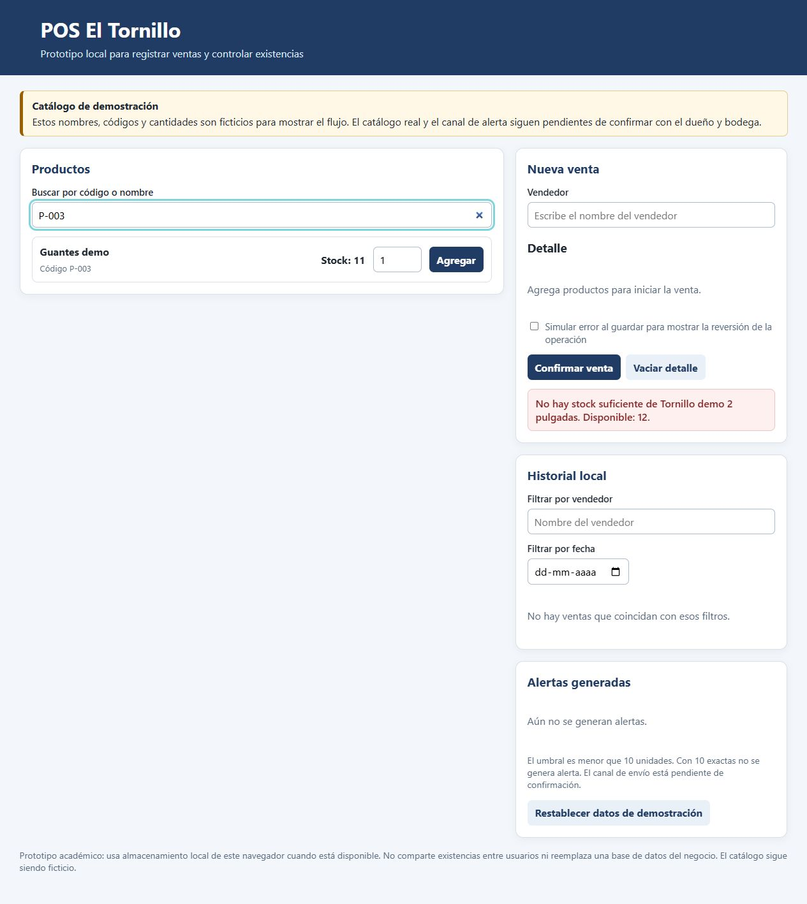

### 02 — Stock insuficiente

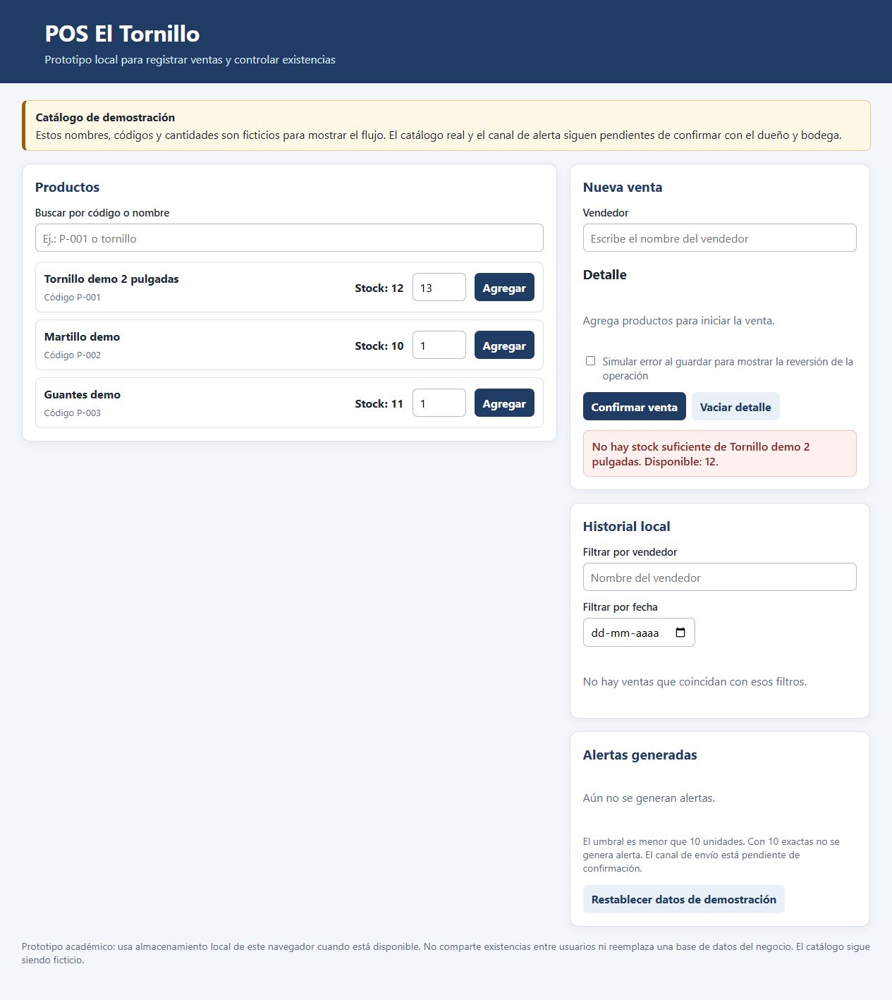

### 03 — Error simulado

### 04 — Venta confirmada

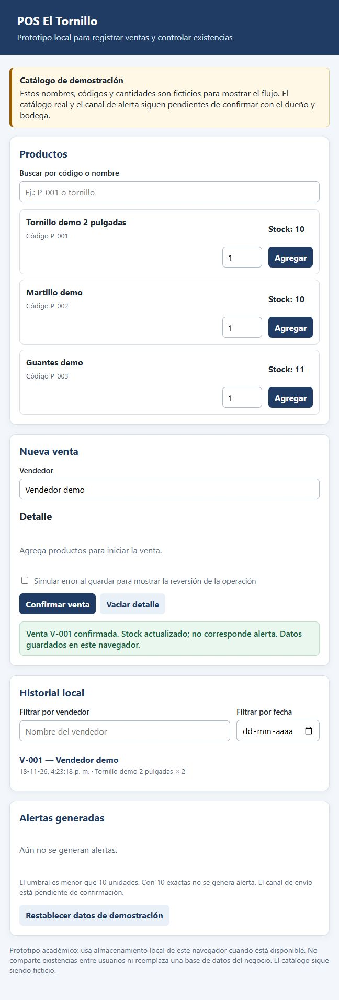

### 05 — Historial filtrado

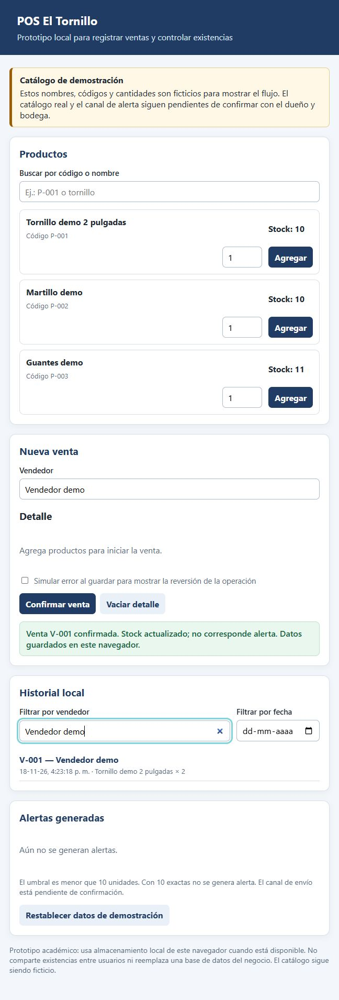

### 06 — Persistencia tras recargar

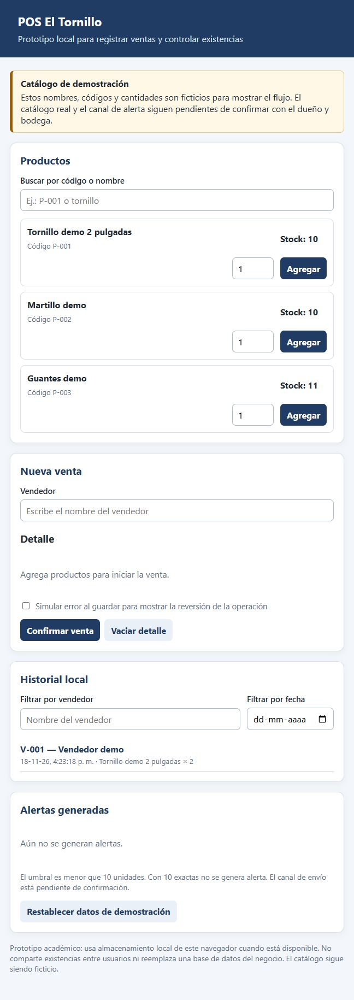

### 07 — Umbral exacto de 10

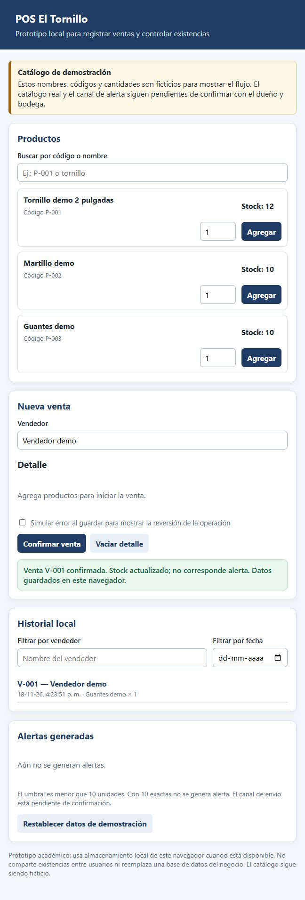

### 08 — Alerta con stock 9

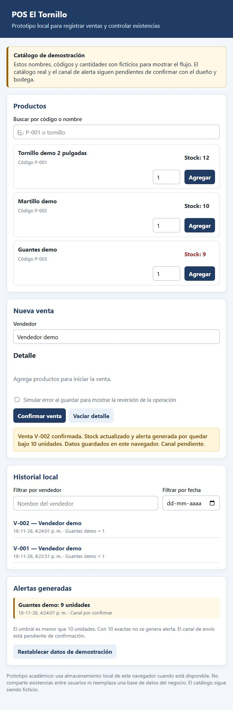

### 09 — Alerta conservada tras recargar

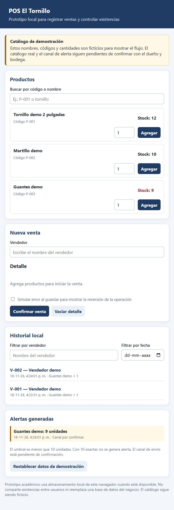

### 10 — Repositorio público

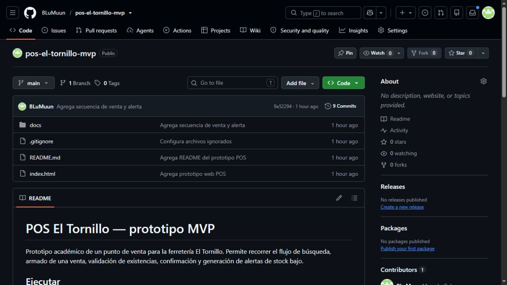

### 11 — Diagramas publicados

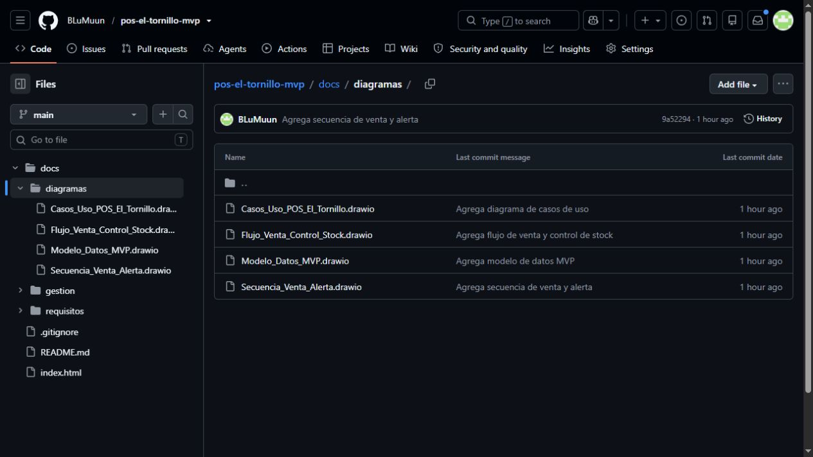

### 12 — Búsqueda sin coincidencias

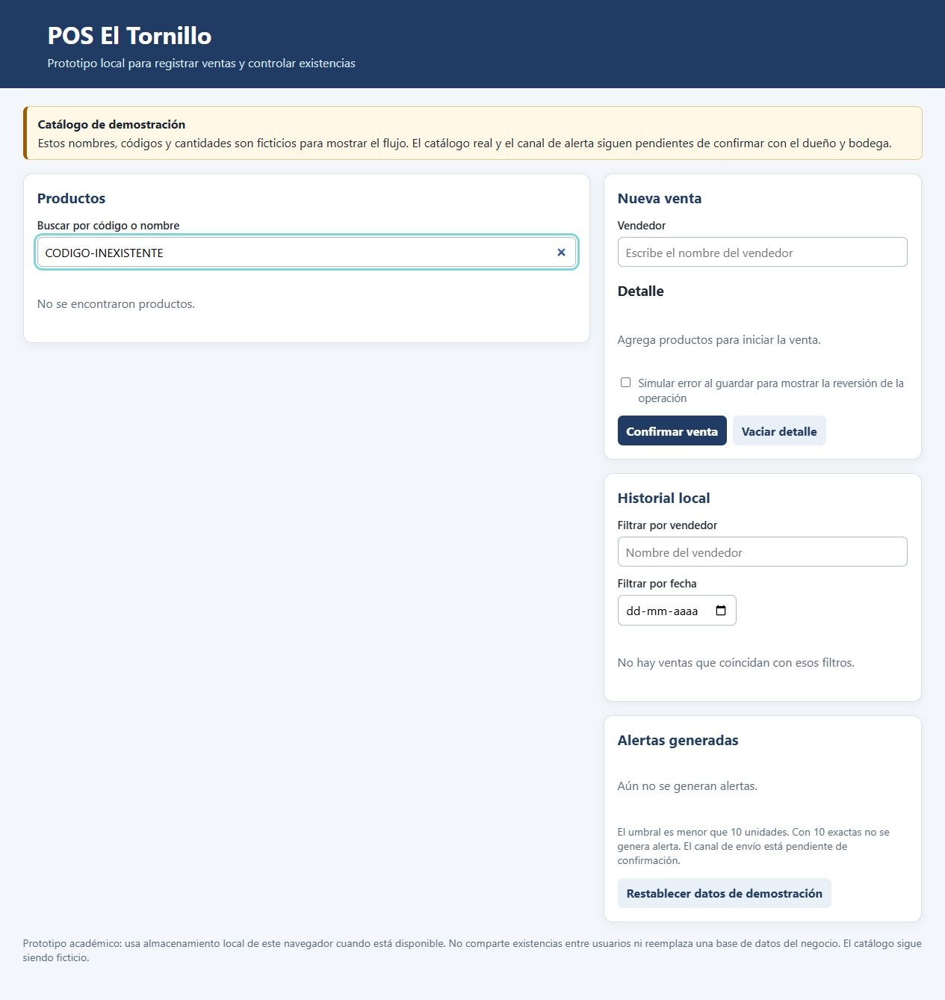

### 13 — Filtro por fecha

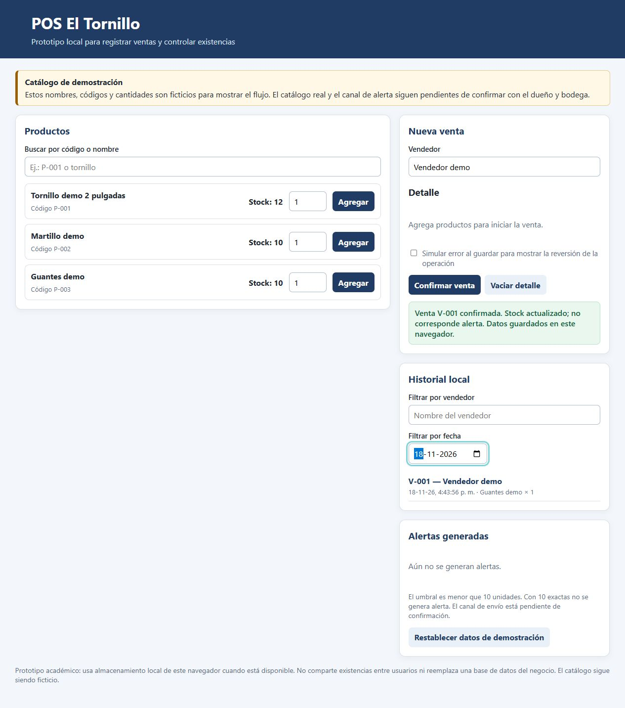

### 14 — Confirmación con detalle vacío

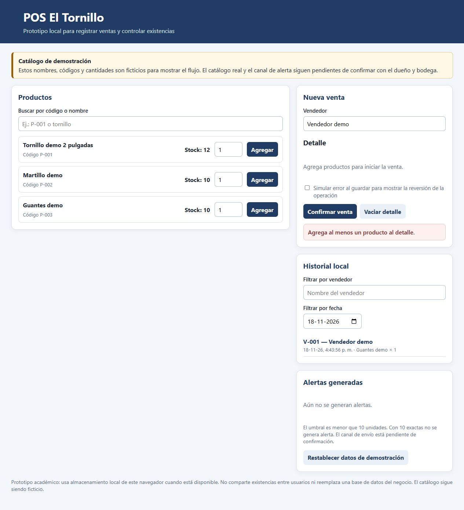

### 15 — Tablero, captura anterior (no actual)

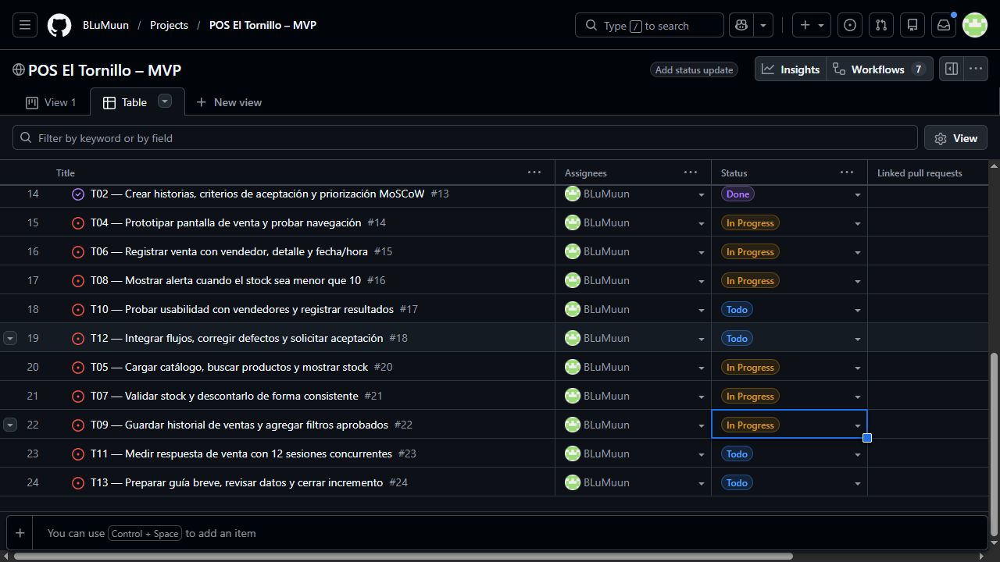

### 16 — Tablero, captura anterior (no actual)

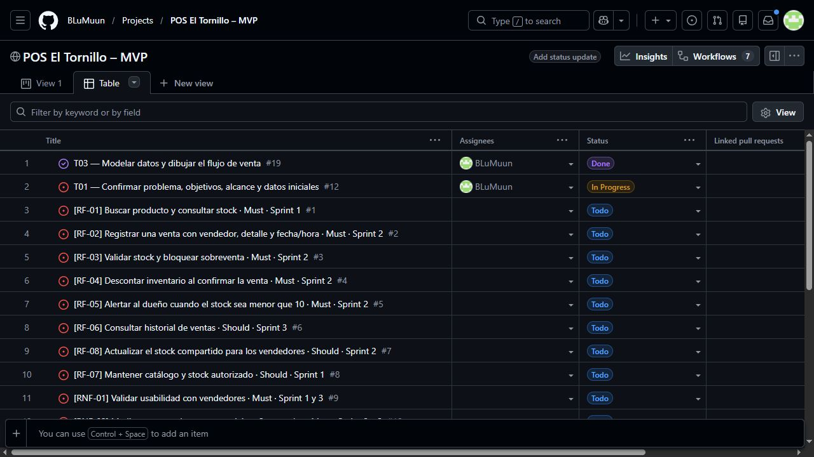
